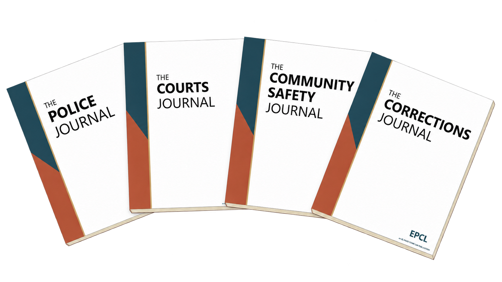

:::::: {.epcl-publications}

::::: {.publications-hero}

::: {.publications-hero-copy}

# EPCL Publications {.unnumbered .unlisted}

::: {.epcl-tagline}
Open-Access Journals in Justice and Public Safety
:::

The **El Paso Crime Lab** publishes four journals featuring research briefs, professional perspectives, and lessons from practice across policing, corrections, courts, and community safety.

<a href="https://forms.gle/65KEVJZxT6PZ4Yfv8" class="epcl-submit-link">Submit a proposal</a>

:::

::: {.publications-hero-art}

{fig-alt="Artwork for the four EPCL journals on policing, corrections, courts, and community safety"}

:::

:::::

---

## Publications and Resources {.epcl-section-title}

Explore published contributions, learn about submitting your work, and discover the editorial standards guiding EPCL Publications.

::: {.panel-tabset}

## Published Articles


```{=html}
<div class="archive-toolbar">

  <div class="archive-control">
    <label for="archive-search">Search publications</label>
    <input
      id="archive-search"
      type="search"
      placeholder="Article title or author name"
    />
  </div>

  <div class="archive-control">
    <label for="archive-journal">Journal</label>
    <select id="archive-journal">
      <option value="">All journals</option>
    </select>
  </div>

  <div class="archive-control">
    <label for="archive-type">Contribution type</label>
    <select id="archive-type">
      <option value="">All categories</option>
    </select>
  </div>

  <div class="archive-control">
    <label for="archive-sort">Sort publications</label>
    <select id="archive-sort">
      <option value="date-desc">Newest first</option>
      <option value="date-asc">Oldest first</option>
      <option value="title-asc">Title A–Z</option>
      <option value="title-desc">Title Z–A</option>
      <option value="clicks-desc">Most clicked</option>
      <option value="clicks-asc">Least clicked</option>
    </select>
  </div>

</div>

<div class="archive-summary">
  <span id="archive-count" aria-live="polite">Loading publications...</span>
  <button type="button" id="archive-reset" class="archive-reset">
    Clear filters
  </button>
</div>

<div id="publication-loading" class="archive-loading">
  Loading published articles...
</div>

<div id="publication-error" class="archive-error" style="display:none;">
  Unable to load publications. Please try again later.
</div>

<div id="publication-archive"></div>

<script>
document.addEventListener("DOMContentLoaded", async function () {

  const API = "https://royal-frost-e27b.editor-epcl.workers.dev";

  const loading = document.getElementById("publication-loading");
  const error = document.getElementById("publication-error");
  const archive = document.getElementById("publication-archive");

  const searchInput = document.getElementById("archive-search");
  const journalFilter = document.getElementById("archive-journal");
  const typeFilter = document.getElementById("archive-type");
  const sortFilter = document.getElementById("archive-sort");
  const countDisplay = document.getElementById("archive-count");
  const resetButton = document.getElementById("archive-reset");

  let publications = [];

  function formatDate(dateString) {

    if (!dateString) return "—";

    const date = new Date(dateString + "T12:00:00");

    if (Number.isNaN(date.getTime())) return "—";

    return date.toLocaleDateString("en-US", {
      month: "short",
      year: "numeric"
    });

  }

  function populateFilters() {

    const journals = [...new Set(
      publications.map(article => article.journal).filter(Boolean)
    )].sort();

    const types = [...new Set(
      publications.map(article => article.article_type).filter(Boolean)
    )].sort();

    journals.forEach(journal => {

      const option = document.createElement("option");
      option.value = journal;
      option.textContent = journal;
      journalFilter.appendChild(option);

    });

    types.forEach(type => {

      const option = document.createElement("option");
      option.value = type;
      option.textContent = type;
      typeFilter.appendChild(option);

    });

  }

  function normalizeSearch(value) {
    return value.normalize("NFD").replace(/\p{M}/gu, "").toLowerCase();
  }

  function getFilteredPublications() {

    const search = normalizeSearch(searchInput.value.trim());
    const journal = journalFilter.value;
    const type = typeFilter.value;
    const sort = sortFilter.value;

    let results = publications.filter(article => {

      const matchesSearch = !search ||
        normalizeSearch(article.title || "").includes(search) ||
        normalizeSearch(article.authors || "").includes(search);

      const matchesJournal = !journal ||
        article.journal === journal;

      const matchesType = !type ||
        article.article_type === type;

      return matchesSearch && matchesJournal && matchesType;

    });

    results.sort((a, b) => {

      switch (sort) {

        case "date-asc":
          return (a.publication_date || "").localeCompare(
            b.publication_date || ""
          );

        case "title-asc":
          return (a.title || "").localeCompare(b.title || "");

        case "title-desc":
          return (b.title || "").localeCompare(a.title || "");

        case "clicks-desc":
          return Number(b.click_count || 0) -
            Number(a.click_count || 0);

        case "clicks-asc":
          return Number(a.click_count || 0) -
            Number(b.click_count || 0);

        case "date-desc":
        default:
          return (b.publication_date || "").localeCompare(
            a.publication_date || ""
          );

      }

    });

    return results;

  }

  function renderArchive() {

    const results = getFilteredPublications();

    countDisplay.replaceChildren();

    const countStrong = document.createElement("strong");
    countStrong.textContent = results.length;

    countDisplay.appendChild(countStrong);

    countDisplay.appendChild(
      document.createTextNode(
        " of " + publications.length +
        (publications.length === 1
          ? " publication"
          : " publications")
      )
    );

    archive.replaceChildren();

    if (!results.length) {

      const empty = document.createElement("div");
      empty.className = "archive-empty";
      empty.textContent =
        "No publications match your search or selected filters.";

      archive.appendChild(empty);
      return;

    }

    const wrapper = document.createElement("div");
    wrapper.className = "archive-table-wrap";

    const table = document.createElement("table");
    table.className = "archive-table";

    const thead = document.createElement("thead");
    const headerRow = document.createElement("tr");

    [
      "Article",
      "Journal",
      "Category",
      "Published",
      "Article clicks"
    ].forEach(label => {

      const th = document.createElement("th");
      th.textContent = label;
      headerRow.appendChild(th);

    });

    thead.appendChild(headerRow);

    const tbody = document.createElement("tbody");

    results.forEach(article => {

      const row = document.createElement("tr");

      const titleCell = document.createElement("td");
      const link = document.createElement("a");

      link.textContent = article.title || "Untitled article";
      link.href = article.pdf_url || "#";

      if (article.pdf_url) {

        link.addEventListener("click", function () {

          fetch(API + "/track", {
            method: "POST",
            headers: {
              "Content-Type": "application/json"
            },
            body: JSON.stringify({
              article_id: article.article_id
            }),
            keepalive: true
          }).catch(console.error);

        });

      }

      titleCell.appendChild(link);

      if (article.authors?.trim()) {
        const byline = document.createElement("span");
        byline.className = "article-authors";
        byline.textContent = article.authors.trim();
        titleCell.appendChild(byline);
      }

      if (article.pdf_url) {
        const format = document.createElement("span");
        format.className = "article-format";
        format.textContent = "PDF · Read article";
        titleCell.appendChild(format);
      }

      const journalCell = document.createElement("td");
      journalCell.textContent = article.journal || "—";

      const typeCell = document.createElement("td");
      typeCell.textContent = article.article_type || "—";

      const dateCell = document.createElement("td");
      dateCell.textContent = formatDate(article.publication_date);

      const clicksCell = document.createElement("td");
      clicksCell.className = "clicks-cell";
      clicksCell.textContent = Number(
        article.click_count || 0
      ).toLocaleString();

      row.append(
        titleCell,
        journalCell,
        typeCell,
        dateCell,
        clicksCell
      );

      tbody.appendChild(row);

    });

    table.append(thead, tbody);
    wrapper.appendChild(table);
    archive.appendChild(wrapper);

  }

  function resetFilters() {

    searchInput.value = "";
    journalFilter.value = "";
    typeFilter.value = "";
    sortFilter.value = "date-desc";

    renderArchive();

  }

  searchInput.addEventListener("input", renderArchive);
  journalFilter.addEventListener("change", renderArchive);
  typeFilter.addEventListener("change", renderArchive);
  sortFilter.addEventListener("change", renderArchive);
  resetButton.addEventListener("click", resetFilters);

  try {

    const response = await fetch(API + "/metrics");

    if (!response.ok) {
      throw new Error("Unable to retrieve publications.");
    }

    publications = await response.json();

    if (!Array.isArray(publications)) {
      throw new Error("Unexpected publication data.");
    }

    loading.remove();

    populateFilters();
    renderArchive();

  } catch (err) {

    loading.remove();
    error.style.display = "block";
    countDisplay.textContent = "Publication archive unavailable.";

    console.error("EPCL Publications:", err);

  }

});
</script>
```

## Aim & Scope

The El Paso Crime Lab publishes research, professional knowledge, and accessible educational resources that advance the science of public safety in the Borderland. Each journal serves a distinct audience and area of the criminal justice system.

### The Community Safety Journal

*The Community Safety Journal* makes research and public safety knowledge accessible to community members, local organizations, policymakers, and other interested readers.

Contributions may examine local public safety concerns, community experiences, criminal justice policy, prevention initiatives, and research findings with practical implications for the Borderland. The journal prioritizes accessible writing and clear explanations that help readers understand complex issues.

### The Police Journal

*The Police Journal* advances research-informed policing by connecting criminological research, professional experience, and practical knowledge.

Contributions may address police organizations, patrol operations, problem-oriented policing, crime analysis, officer development, organizational leadership, program evaluation, and emerging issues in law enforcement. The journal welcomes research briefs, educational explainers, professional perspectives, and evaluations of policing strategies.

### The Corrections Journal

*The Corrections Journal* examines the institutions, practices, and policies that shape correctional systems.

Contributions may address jails, prisons, community corrections, institutional safety, rehabilitation, reentry, correctional personnel, and organizational management. The journal emphasizes evidence-informed approaches to improving correctional practice and outcomes.

### The Courts Journal

*The Courts Journal* explores the administration, operation, and impact of courts and related justice institutions.

Contributions may address court administration, case processing, pretrial practices, sentencing, access to justice, judicial policy, and the experiences of individuals navigating the court system. The journal encourages research and practical perspectives that support effective, fair, and informed justice processes.

## For Authors

Have knowledge or experience to share? We welcome contributions from researchers, public safety professionals, students, and community members.

### Three types of contributions

::: {.contribution-grid}

::: {.contribution-card}
### Research & Education

Explain research, share findings, or teach readers about a topic.
:::

::: {.contribution-card}
### Perspectives & Debate

Share an informed opinion or offer a different way to think about an issue.
:::

::: {.contribution-card}
### Practice & Experience

Share practical advice, professional experiences, or lessons learned.
:::

:::

### How to get published

1. Submit a short proposal describing your idea.
2. Two editors independently review your proposal without knowing your identity.
3. If approved, write and submit your article.
4. Two editors independently review your blinded article and may request changes.
5. If accepted, your article is prepared for publication.

All proposals and articles undergo blinded editorial review to promote fairness and reduce bias.

You do not need a finished article to submit a proposal.

[Submit a proposal](https://forms.gle/Dn8UZbmUbnepcMeW7){.epcl-submit-link}

## For Editors

### Become an editor

Help make practical public safety knowledge easier to find and use. If you have experience in policing, corrections, courts, or community safety through your work or research, we’d like to hear from you.

[Send a message](https://www.epcrimelab.org/contact.html) letting us know which journal interests you and share a few sentences about your background.

### How a review works

Editors review short proposals and full articles. Each assignment arrives by email and has its own review link.

```{=html}
<ol class="editor-review-steps">
  <li><strong>Open the email</strong><span>You’ll get a link to your assignment.</span></li>
  <li><strong>Read the submission</strong><span>Review the work and answer a few questions.</span></li>
  <li><strong>Submit your decision</strong><span>Send your decision and any feedback in the same form.</span></li>
</ol>
```

[Open the Editor Quick Guide (PDF)](assets/EPCL_Publications_Editor_Quick_Guide.pdf)

```{=html}
<iframe
  class="editor-quick-guide"
  src="assets/EPCL_Publications_Editor_Quick_Guide.pdf"
  title="EPCL Publications Editor Quick Guide"
  loading="lazy">
</iframe>
```

### Editorial policies

EPCL bases publication decisions on the quality, relevance, and fit of each submission. Two editors independently review each proposal and article without seeing the author’s identity, and EPCL resolves split decisions. Authors are responsible for the accuracy of their work and for crediting their sources. Authors and editors should disclose any interests or relationships that could influence their work or judgment. EPCL explains copyright and reuse terms during submission and acceptance and may issue a correction, expression of concern, or retraction when needed.

## Editorial Leadership

```{=html}
<div class="editorial-roster-scroll" tabindex="0" role="region" aria-label="Editorial roster">
  <div class="editorial-roster" style="grid-template-columns: minmax(0, 1fr);">
    <section>
      <h3>Current Editors</h3>
      <ul>
        <li><strong>Editor Name</strong>, <em>Affiliation</em></li>
      </ul>

      <h3>Past Editors</h3>
      <ul>
        <li><strong>Editor Name</strong>, <em>Affiliation</em></li>
      </ul>
    </section>
  </div>
</div>
```

## Themed Collections

Themed collections bring together articles on a shared public safety topic.

::: {.content-notice}
**Have an idea for a collection? Let us know.**

Send your idea using our [contact page](https://www.epcrimelab.org/contact.html).
:::

No themed collections are currently open for submissions.

:::

::: {.publications-footer}

**El Paso Crime Lab**

*Advancing the Science of Public Safety.*

Good policy begins with good evidence.

:::


::::::

```{=html}
<style>
/* Hide Quarto's duplicate title block; retain the custom editorial hero. */
#title-block-header.quarto-title-block, #title-block-header { display: none !important; }
/* EPCL editorial design — scoped to this page */
.epcl-publications {
  --ink: #263238; --muted: #59676e; --line: #d9dfe1;
  --paper: #fff; --wash: #f4f6f6; --accent: #315e70; --gold: #b8862f;
  font-family: "Segoe UI", system-ui, sans-serif;
  color: var(--ink); max-width: 1280px; margin: 0 auto; padding: 0 24px;
  line-height: 1.65;
}
.epcl-publications h1,.epcl-publications h2,.epcl-publications h3 {color:var(--ink); letter-spacing:-.025em;}
.epcl-publications h2 {font-size:1.75rem; font-weight:650; border:0;}
.epcl-publications h3 {font-size:1.2rem; font-weight:650; margin-top:2rem;}
.epcl-publications p {max-width:82ch;}
.epcl-publications a {color:var(--accent);}
.epcl-publications a:focus-visible,.epcl-publications button:focus-visible {outline:2px solid var(--accent); outline-offset:4px;}
.epcl-publications .panel-tabset {margin:1.5rem 0 3rem;}
 .epcl-publications .panel-tabset .nav-tabs {
  display:flex; flex-wrap:wrap; gap:.35rem; padding:0 0 .45rem;
  border:0; border-bottom:1px solid var(--line); background:transparent;
}
.epcl-publications .panel-tabset .nav-tabs .nav-link {
  margin:0; border:0 !important; border-bottom:3px solid transparent !important;
  border-radius:6px 6px 3px 3px; background:transparent !important;
  color:var(--muted) !important; font-size:.94rem; font-weight:600;
  padding:.8rem 1rem; text-decoration:none; box-shadow:none;
  transition:background-color .18s ease,color .18s ease,border-color .18s ease;
}
.epcl-publications .panel-tabset .nav-tabs .nav-link:hover {
  background:#e7f0f4 !important; color:#244e60 !important;
  border-bottom-color:#91b5c5 !important;
}
.epcl-publications .panel-tabset .nav-tabs .nav-link.active,
.epcl-publications .panel-tabset .nav-tabs .nav-link[aria-selected="true"] {
  background:#315e70 !important; color:#fff !important;
  border-bottom-color:var(--gold) !important;
}
.epcl-publications .panel-tabset .nav-tabs .nav-link.active:hover {
  background:#244e60 !important; color:#fff !important;
}
.epcl-publications .panel-tabset .nav-tabs .nav-link:focus-visible {
  outline:2px solid var(--accent); outline-offset:2px;
}
@media(prefers-reduced-motion:reduce){.epcl-publications .panel-tabset .nav-tabs .nav-link{transition:none;}}
.epcl-publications .panel-tabset .tab-content {border:0; padding:1.8rem 0;}
.epcl-publications .archive-toolbar {display:grid; grid-template-columns:2fr 1fr 1fr 1fr; gap:1rem; padding:1.3rem; background:var(--wash); border-top:2px solid var(--ink); margin:1.5rem 0; align-items:end;}
.epcl-publications .archive-control label {display:block; font-size:.75rem; font-weight:650; letter-spacing:.05em; text-transform:uppercase; color:var(--muted); margin-bottom:.45rem;}
.epcl-publications .archive-control input,.epcl-publications .archive-control select {width:100%; min-width:0; min-height:44px; border:1px solid var(--line); border-radius:2px; padding:.65rem; background:var(--paper); color:var(--ink); font:inherit; font-size:.88rem;}
.epcl-publications .archive-control :focus {outline:2px solid var(--accent); outline-offset:1px;}
.epcl-publications .archive-summary {display:flex; justify-content:space-between; align-items:center; gap:1rem; color:var(--muted); font-size:.88rem; margin:1rem 0;}
.epcl-publications .archive-reset {background:none; border:0; color:var(--accent); font-weight:600; cursor:pointer; padding:.4rem;}
.epcl-publications .archive-reset:hover {text-decoration:underline;}
.epcl-publications .archive-table-wrap {overflow-x:auto;}
.epcl-publications .archive-table {width:100%; border-collapse:collapse; font-size:.9rem; min-width:680px;}
.epcl-publications .archive-table th {text-align:left; padding:.85rem .8rem; border-top:1px solid var(--line); border-bottom:2px solid var(--ink); color:var(--muted); font-size:.72rem; text-transform:uppercase; letter-spacing:.07em; white-space:nowrap;}
.epcl-publications .archive-table td {padding:1.35rem .8rem; border-bottom:1px solid var(--line); vertical-align:top;}
.epcl-publications .archive-table td:first-child {width:42%;}
.epcl-publications .archive-table a {font-size:1.12rem; line-height:1.35; font-weight:650; color:var(--ink); text-decoration:none;}
.epcl-publications .archive-table a:hover {color:var(--accent); text-decoration:underline;}
.epcl-publications .article-format {display:block; color:var(--muted); font-size:.75rem; margin-top:.45rem;}
.epcl-publications .archive-table tr:hover td {background:var(--wash);}
.epcl-publications .clicks-cell {font-variant-numeric:tabular-nums; text-align:right;}
.epcl-publications .archive-table th:last-child {text-align:right;}
.epcl-publications .archive-empty,.epcl-publications .archive-loading,.epcl-publications .archive-error {padding:2rem; border:1px solid var(--line); color:var(--muted); text-align:center;}
.epcl-publications .archive-error {color:#8a3028;}
.epcl-publications .contribution-grid {display:grid; grid-template-columns:repeat(3,minmax(0,1fr)); gap:1.5rem; margin:1.5rem 0 2.5rem;}
.epcl-publications .contribution-card {border-top:3px solid var(--gold); padding:1.2rem 0; border-bottom:1px solid var(--line);}
.epcl-publications .contribution-card h3 {margin:0 0 .8rem;}
.epcl-publications .contribution-card p {margin:0;}
.epcl-publications .process-step {border-top:1px solid var(--line); padding:1.1rem 0; max-width:85ch;}
.epcl-publications .process-step p {margin:0 0 .4rem;}
.epcl-publications .process-step strong {color:var(--accent);}
.epcl-publications .content-notice {border-left:3px solid var(--gold); background:var(--wash); padding:1.25rem 1.5rem; margin:1.5rem 0;}
.epcl-publications .content-notice p:last-child {margin:0;}
.epcl-publications .publications-footer {border-top:3px solid var(--ink); padding:1.6rem 0 2rem; color:var(--muted); font-size:.9rem;}
.epcl-publications .publications-footer strong {color:var(--ink); font-size:1.2rem;}
.epcl-publications .publications-footer p {margin:.25rem 0;}
@media(max-width:900px){.epcl-publications .archive-toolbar{grid-template-columns:repeat(2,minmax(0,1fr));}.epcl-publications .contribution-grid{grid-template-columns:1fr;gap:.75rem;}}
@media(max-width:560px){.epcl-publications{padding:0 12px;}.epcl-publications .archive-toolbar{grid-template-columns:1fr;}.epcl-publications .panel-tabset .nav-tabs{gap:.25rem;}.epcl-publications .panel-tabset .nav-tabs .nav-link{font-size:.85rem;padding:.65rem .75rem;}}
[data-bs-theme="dark"] .epcl-publications {--ink:#e7ecee;--muted:#b3c0c6;--line:#46535a;--paper:#20282d;--wash:#2a353b;--accent:#a0c9da;}


.epcl-publications .epcl-submit-link { display:inline-block; background:#315e70; color:#fff; padding:.75rem 1.2rem; border-radius:3px; font-weight:600; text-decoration:none; }
.epcl-publications .epcl-submit-link:hover { background:#244e60; color:#fff; }

/* Refined editorial finish — visual changes only */
.epcl-publications { --gold:#a98242; --line:#dce3e6; --wash:#f5f7f8; }
.epcl-publications .epcl-submit-link {background:#284b5b; border:1px solid #284b5b; color:#fff; border-radius:6px; transition:background-color .18s ease,box-shadow .18s ease;}
.epcl-publications .epcl-submit-link:hover {background:#1d3947; color:#fff; box-shadow:0 3px 10px #00000015;}
.epcl-publications .panel-tabset .nav-tabs {gap:.4rem; padding-bottom:.75rem;}
.epcl-publications .panel-tabset .nav-tabs .nav-link {border-radius:6px; border-bottom:2px solid transparent !important; padding:.7rem .95rem;}
.epcl-publications .panel-tabset .nav-tabs .nav-link.active,
.epcl-publications .panel-tabset .nav-tabs .nav-link[aria-selected="true"] {background:#e8eff2 !important; color:#284b5b !important; border-bottom-color:#a98242 !important;}
.epcl-publications .panel-tabset .nav-tabs .nav-link.active:hover {background:#dbe8ee !important; color:#284b5b !important;}
.epcl-publications .archive-toolbar {border:1px solid var(--line); border-radius:8px; padding:1.35rem;}
.epcl-publications .archive-control input,.epcl-publications .archive-control select {border-radius:5px;}
.epcl-publications .archive-control label {font-size:.72rem; letter-spacing:.065em;}
.epcl-publications .archive-table th {background:var(--wash); border-top:0; border-bottom:1px solid var(--line);}
.epcl-publications .archive-table td {padding:1.25rem .85rem;}
.epcl-publications .archive-table a {font-weight:650; letter-spacing:-.015em;}
.epcl-publications .article-format {color:var(--accent);}
.epcl-publications .archive-table-wrap {border:1px solid var(--line); border-radius:7px;}
.epcl-publications .archive-table tbody tr:last-child td {border-bottom:0;}
.epcl-publications .contribution-card {border:1px solid var(--line); border-top:3px solid var(--gold); border-radius:6px; padding:1.35rem; background:var(--paper);}
.epcl-publications .content-notice {border-radius:0 6px 6px 0;}
.epcl-publications .publications-footer {border-top:1px solid var(--line); padding-top:1.8rem;}
[data-bs-theme="dark"] .epcl-publications {--line:#46535a; --wash:#2a353b;}
[data-bs-theme="dark"] .epcl-publications .panel-tabset .nav-tabs .nav-link.active,
[data-bs-theme="dark"] .epcl-publications .panel-tabset .nav-tabs .nav-link[aria-selected="true"] {background:#354b57 !important; color:#e7ecee !important;}
[data-bs-theme="dark"] .epcl-publications .panel-tabset .nav-tabs .nav-link.active:hover {background:#405b69 !important; color:#fff !important;}
@media(prefers-reduced-motion:reduce){.epcl-publications .epcl-submit-link{transition:none;}}


/* Higher-contrast editorial surfaces */
.epcl-publications { --wash:#dce6eb; --line:#a4bac6; }
.epcl-publications .panel-tabset .nav-tabs .nav-link.active,
.epcl-publications .panel-tabset .nav-tabs .nav-link[aria-selected="true"] {background:#315e70 !important; color:#fff !important;}
.epcl-publications .panel-tabset .nav-tabs .nav-link.active:hover {background:#244e60 !important; color:#fff !important;}
.epcl-publications .archive-toolbar {background:var(--wash); border-color:var(--line);}
.epcl-publications .archive-control label {color:var(--ink);}
.epcl-publications .contribution-card {background:#e8eff3; border-color:var(--line); border-top-color:var(--gold);}
.epcl-publications .content-notice {background:var(--wash);}
[data-bs-theme="dark"] .epcl-publications {--wash:#354b57; --line:#607986;}
[data-bs-theme="dark"] .epcl-publications .contribution-card {background:#304550;}
[data-bs-theme="dark"] .epcl-publications .panel-tabset .nav-tabs .nav-link.active,
[data-bs-theme="dark"] .epcl-publications .panel-tabset .nav-tabs .nav-link[aria-selected="true"] {background:#426678 !important; color:#fff !important;}


.epcl-publications .editorial-roster-scroll {
  overflow-x: auto;
  margin: 1.25rem 0 2rem;
}
.epcl-publications .editorial-roster {
  display: grid;
  grid-template-columns: repeat(4, minmax(max-content, 1fr));
  gap: 1.5rem;
  font-size: .8rem;
}
.epcl-publications .editorial-roster :is(h3, h4) {
  color: inherit;
  letter-spacing: normal;
  white-space: nowrap;
}
.epcl-publications .editorial-roster h3 {
  font-size: .88rem;
  margin: 0 0 .8rem;
}
.epcl-publications .editorial-roster h4 {
  font-size: inherit;
  font-weight: 600;
  margin: .85rem 0 .25rem;
}
.epcl-publications .editorial-roster ul {
  list-style: none;
  margin: 0;
  padding: 0;
  white-space: nowrap;
}
.epcl-publications .editor-review-steps {
  display: grid;
  grid-template-columns: repeat(3, minmax(0, 1fr));
  gap: 1.75rem;
  list-style: none;
  padding: 0;
  margin: 1rem 0 2rem;
}
.epcl-publications .editor-review-steps li {
  position: relative;
  border-top: 2px solid var(--gold);
  padding-top: .65rem;
}
.epcl-publications .editor-review-steps span {
  display: block;
  margin-top: .2rem;
}
.epcl-publications .editor-review-steps li + li::before {
  content: "→" / "";
  position: absolute;
  right: calc(100% + .45rem);
  color: var(--muted);
}
@media (max-width: 620px) {
  .epcl-publications .editor-review-steps {
    grid-template-columns: 1fr;
    gap: 1.5rem;
  }
  .epcl-publications .editor-review-steps li + li::before {
    content: "↓" / "";
    right: auto;
    top: -1.45rem;
  }
}

/* Stacked masthead for the wide, transparent journal-cover artwork. */
.epcl-publications .publications-hero {
  display: grid;
  justify-items: center;
  gap: clamp(1.4rem, 3.5vw, 2.5rem);
  padding-block: clamp(1.5rem, 4vw, 3.25rem) clamp(1.25rem, 3vw, 2.5rem);
  text-align: center;
}
.epcl-publications .publications-hero h1 {
  margin: 0 0 .55rem;
  font: 600 clamp(2.4rem, 6vw, 5rem)/1.04 Georgia, "Times New Roman", serif;
  letter-spacing: -.045em;
}
.epcl-publications .epcl-tagline {
  font-size: clamp(1rem, 2vw, 1.28rem);
  font-weight: 600;
  color: var(--accent);
}
.epcl-publications .publications-hero-copy p {
  max-width: 60ch;
  margin-inline: auto;
}
.epcl-publications .publications-hero-copy > p:last-child {
  margin-bottom: 0;
}
.epcl-publications .publications-hero .epcl-submit-link {
  background: transparent;
  border: 0;
  padding: 0;
  color: var(--accent);
  text-decoration: underline;
  text-underline-offset: .25em;
}
.epcl-publications .publications-hero .epcl-submit-link:hover {
  box-shadow: none;
}
.epcl-publications .publications-hero .epcl-submit-link::after {
  content: " →" / "";
  display: inline-block;
  margin-left: .35em;
}
.epcl-publications .publications-hero-art {
  width: min(100%, 51rem);
}
.epcl-publications .publications-hero-art :is(p, figure) {
  max-width: none;
  margin: 0;
}
.epcl-publications .publications-hero-art img {
  display: block;
  width: 100%;
  height: auto;
  /* Crop the transparent margin above and below the covers. */
  aspect-ratio: 2048 / 908;
  object-fit: cover;
  object-position: center 59%;
}

.epcl-publications .article-authors {
  display: block;
  margin-top: .35rem;
  color: var(--ink);
  font-size: .89rem;
  overflow-wrap: anywhere;
}
.epcl-publications .editor-quick-guide {
  display: block;
  width: 100%;
  height: clamp(22rem, 70vh, 46rem);
  border: 1px solid var(--line);
  margin: .75rem 0 2rem;
}
</style>
```
