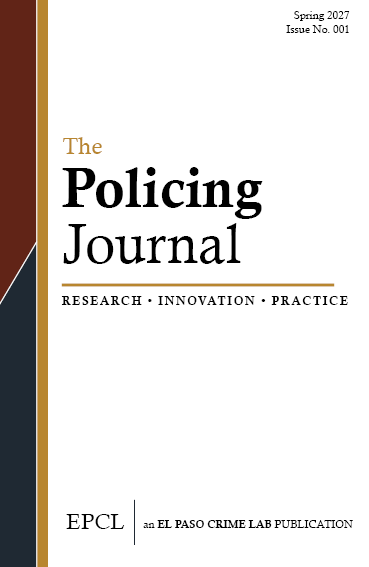
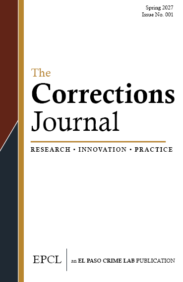
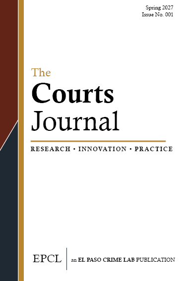
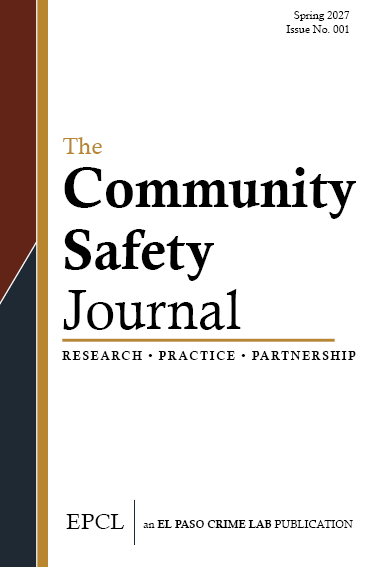

---
title: "Journal Submissions"
subtitle: "Contributing to the science and practice of criminal justice"
description: "Explore EPCL publications and submit a contribution proposal."
page-layout: article
toc: false
---

EL PASO CRIME LAB · PUBLICATIONS

# Advancing knowledge. Improving practice.

EPCL publications bring together researchers, criminal justice professionals, educators, and students to examine important issues, communicate evidence, and share ideas that move the field forward.

Whether you work in criminal justice, study it, or are interested in improving it, there is a place for your contribution.

<a href="#publications" class="hero-button">Explore our publications ↓</a>

## Our Publications

Four publications. Four areas of focus. One shared commitment to advancing the science and practice of criminal justice.

Select a publication to explore its subject matter and determine where your proposed contribution belongs.

01 · POLICING

### The Policing Journal

Examining policing, police organizations, leadership, officer development, and evidence-based approaches to public safety.

**Areas of interest**

Police management · Problem-oriented policing · Organizational culture · Officer training · Crime analysis · Accountability · Police-community relationships

02 · CORRECTIONS

### The Corrections Journal

Examining correctional institutions, detention, incarceration, rehabilitation, reentry, and correctional administration.

**Areas of interest**

Institutional management · Correctional officer development · Rehabilitation · Inmate programming · Recidivism · Reentry · Correctional policy

03 · COURTS

### The Courts Journal

Examining judicial administration, prosecution, defense, adjudication, and the broader administration of justice.

**Areas of interest**

Court efficiency · Case processing · Judicial decision-making · Diversion · Sentencing · Procedural justice · Access to justice

04 · COMMUNITY SAFETY

### The Community Safety Journal

Examining public safety beyond traditional criminal justice institutions, including prevention, community partnerships, and local government.

**Areas of interest**

Crime prevention · Community interventions · Public health approaches · Neighborhood conditions · Local policy · Interagency collaboration

**Our editorial philosophy**

Meaningful progress requires collaboration between those who study criminal justice and those who work within it.

EPCL seeks contributions that are intellectually rigorous, accessible to professional audiences, and relevant to the communities and institutions served by the criminal justice system.

## What Can You Contribute?

EPCL welcomes different forms of professional and scholarly contributions. You do not need to be an academic researcher or have previous publication experience.

CATEGORY 01

### Research & Education

Communicating research and expanding professional knowledge.

- Original research
- Literature reviews
- Research summaries
- Educational explainers
- Program evaluations
- Evidence-based practice reviews
- Methodological discussions

CATEGORY 02

### Perspectives & Debate

Examining ideas, challenging assumptions, and encouraging informed discussion.

- Policy analyses
- Professional commentary
- Evidence-based opinion essays
- Ethical discussions
- Institutional critiques
- Emerging criminal justice issues

CATEGORY 03

### Practice & Experience

Sharing professional knowledge and practical experience.

- Case studies
- Innovative practices
- Implementation experiences
- Lessons from the field
- Professional interviews
- Operational problem-solving
- Agency initiatives

## How the Submission Process Works

EPCL uses a proposal-first process. You do not need to prepare a complete manuscript before receiving an initial editorial decision.

01

### Submit a proposal

Choose a publication and contribution category. Describe your proposed topic, its purpose, and its anticipated contribution.

02

### Editorial review

Two editors assigned to the selected publication independently review the proposal for relevance, originality, potential contribution, and suitability.

03

### Receive a decision

You will receive an approval, denial, or request for modification. Approval is an invitation to develop a manuscript, not a guarantee of publication.

04

### Develop your manuscript

Approved contributors receive the universal EPCL manuscript template and submission instructions. The standard development period is 30 days, subject to approved extensions.

05

### Manuscript evaluation

Editors assess the completed manuscript for quality, clarity, accuracy, relevance, and suitability. Revisions may be requested.

06

### Publication preparation

Accepted manuscripts proceed to final editorial preparation and publication.

<strong>30 Days</strong>
Standard manuscript development period

<strong>2 Editors</strong>
Assigned to each publication proposal

<strong>$0</strong>
Submission fee

## Manuscript Preparation

Approved contributors will receive instructions for developing their full manuscripts.

CONTRIBUTOR RESOURCE

### EPCL Universal Manuscript Template

A standardized Microsoft Word template designed for all four EPCL publications and three contribution categories.

Includes:

- Author information and title page.
- Instructions for blinded editorial review.
- Suggested manuscript structures.
- Abstract and keyword sections.
- APA-formatted references.
- Tables, figures, and appendices guidance.

**Formatting standard:** APA 7th edition · Times New Roman · 12-point · Double-spaced · 1-inch margins.

<a href="EPCL_Universal_Manuscript_Submission_Template.docx" class="template-link" download>↓ Download Manuscript Template</a>

## Submission Guidelines

A few important requirements to understand before submitting your proposal.

Who is eligible to contribute?

EPCL welcomes criminal justice practitioners, researchers, academic faculty, undergraduate and graduate students, administrators, policymakers, retired professionals, and other individuals with relevant knowledge or experience.

Institutional affiliation, academic credentials, and previous publication experience are not prerequisites.

Originality and intellectual property

Contributions should represent original work and must not infringe upon the intellectual property rights of others.

Contributors are responsible for appropriately acknowledging sources. Previously published material, manuscripts under consideration elsewhere, and substantially overlapping submissions must be disclosed.

Professional and ethical standards

Contributors must:

- Properly attribute sources and intellectual contributions.
- Disclose relevant conflicts of interest.
- Identify applicable funding and material support.
- Obtain permissions for copyrighted materials.
- Protect confidential and personally identifiable information.
- Obtain appropriate authorization for research involving human participants when required.

EPCL may request clarification regarding research ethics, institutional approvals, or data permissions.

Manuscript formatting requirements

Full manuscripts must follow APA Publication Manual, Seventh Edition, unless otherwise instructed.

| Element | Requirement |
|:--|:--|
| Citation style | APA 7th edition |
| Font | Times New Roman, 12-point |
| Spacing | Double-spaced |
| Margins | 1 inch |
| Alignment | Left-aligned |
| Indentation | 0.5 inch |
| Page numbering | Upper-right corner |
| File format | Microsoft Word (.docx) |

Additional publication-specific instructions may be provided by the editorial team.

How does editorial review work?

Proposals are reviewed by two editors assigned to the selected publication.

Completed manuscripts undergo editorial evaluation for relevance, quality, accuracy, clarity, and suitability.

This process should not be interpreted as external, independent scholarly peer review unless a particular publication explicitly identifies it as such.

Does approval guarantee publication?

No. Proposal approval is an invitation to develop a full manuscript. The completed manuscript must undergo editorial evaluation before a final publication decision is made.

Can I submit to multiple publications?

Contributors should select the publication most closely aligned with their subject matter.

If a proposed contribution could reasonably fit multiple publications, indicate this in the proposal description so the editorial team can consider its placement.

CONTRIBUTE TO EPCL PUBLICATIONS

## Have an idea worth sharing?

The advancement of criminal justice depends on research, professional experience, critical discussion, and the willingness to explore better approaches.

Whether you are a researcher, practitioner, educator, or student, we welcome your perspective.

**Start with an idea. We will help guide you through the process.**

<a href="YOUR_GOOGLE_APPS_SCRIPT_SUBMISSION_URL" target="_blank" rel="noopener">Submit a Contribution Proposal →</a>

**El Paso Crime Lab**

Advancing the science of public safety.

[EPCL Website](https://epcrimelab.org)

